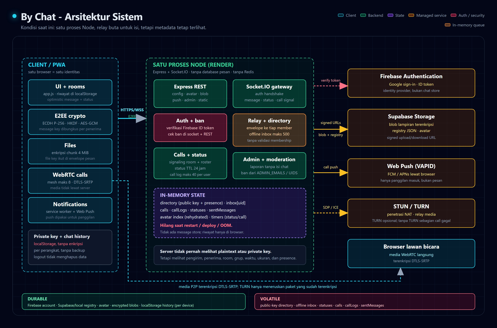
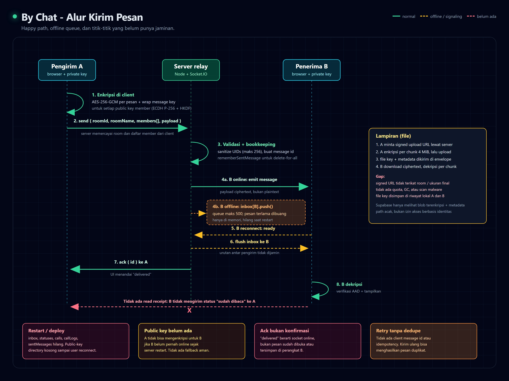

# System Design - By Chat

Dokumen ini menjelaskan **kondisi sistem saat ini**, bukan target ideal. Isinya
dibuat dari kode di repo ini, bukan dari asumsi fitur di README. Tujuannya:
memberi gambaran utuh tentang arsitektur, data, alur, batas keamanan, dan
kekurangan yang perlu ditutup sebelum aplikasi dipakai di luar lingkaran kecil.

- Status: snapshot per 19 Oktober 2026
- Cakupan: server, client web, storage, auth, notifikasi, panggilan, moderasi
- Dokumen terkait: [`README.md`](../README.md), [`STRUCTURE.md`](STRUCTURE.md),
  [`DESIGN.md`](DESIGN.md)
- Sifat angka di sini: **batas implementasi**, bukan hasil load test

## 1. Ringkasan eksekutif

By Chat adalah aplikasi chat web dengan enkripsi end-to-end. Server hanya
meneruskan envelope terenkripsi, menyimpan blob lampiran yang sudah dienkripsi,
dan tidak pernah memegang private key pengguna. Login memakai Firebase
Authentication. Lampiran disimpan di Supabase Storage (atau disk lokal saat
development). Panggilan memakai WebRTC mesh dan server hanya menjadi relay
SDP/ICE.

Arsitektur ini cukup untuk pilot atau komunitas kecil dengan satu instance.
Kekuatan utamanya ada di kerahasiaan isi pesan. Kelemahan utamanya ada di
**durability, abuse control, multi-device, dan skalabilitas**: sebagian besar
state hidup di memori satu proses Node, tidak ada message store di server, dan
tidak ada batas per operasi untuk mengirim pesan, status, atau panggilan.

### Yang sudah baik

- Isi pesan, nama file, dan isi lampiran tidak pernah dikirim sebagai plaintext
  ke server (`public/js/crypto.js`, `public/js/files.js`).
- Lampiran dienkripsi per chunk dengan AES-GCM dan additional authenticated data
  sehingga chunk tidak bisa diurutkan ulang atau dipotong tanpa terdeteksi
  (`public/js/crypto.js:208-255`).
- Private key tidak pernah dikirim ke server; handshake hanya membawa public key
  (`src/server.js:697-716`).
- Namespace username dinormalisasi, case-insensitive, dan menolak nama yang
  mirip setelah separator dibuang (`src/usernames.js:45-68`).
- Blokir admin ditegakkan di socket dan seluruh endpoint REST, bukan hanya di UI
  (`src/server.js:441-457`, `src/server.js:577-588`).
- Laporan moderasi tidak memuat isi chat; laporan hanya berisi alasan dan catatan
  yang ditulis pelapor (`src/moderation.js:1-19`).
- Path blob dibuat server dan divalidasi lagi saat dibaca, sehingga path traversal
  tidak lolos (`src/storage.js:21-50`).
- Ada test kriptografi dan end-to-end yang cukup serius (`test/crypto.test.mjs`,
  `test/e2e.test.mjs`).

### Bottleneck utama

1. **State penting hilang saat restart.** Inbox offline, status, call log,
   daftar pesan yang bisa dihapus, dan public key directory semuanya in-memory.
2. **Tidak ada batas per operasi.** Payload Socket.IO 5 MB, inbox 500 per user,
   status 30 per user, dan pengiriman pesan/panggilan tanpa rate limit.
3. **Tidak ada message store.** Riwayat hanya ada di `localStorage` perangkat.
4. **Model grup dan audience status ditentukan client.** Server tidak punya
   registry room dan tidak memverifikasi siapa boleh masuk room atau melihat
   status.
5. **E2EE-nya statis.** Tidak ada ratchet, forward secrecy, post-compromise
   security, key transparency, atau backup kunci.
6. **Satu proses, satu sesi.** Tidak ada Redis/adapter Socket.IO, tidak ada
   multi-device, dan sesi lama langsung diputus saat akun dibuka di tempat lain.

Kesimpulan singkat: **layak untuk demo dan penggunaan kecil, belum layak untuk
pengguna publik yang mengharapkan riwayat aman, multi-perangkat, dan moderasi
yang bisa dipertanggungjawabkan.**

## 2. Scope dan requirement

### Functional requirements yang benar-benar ada

- Login Google melalui Firebase Authentication, atau mode dev untuk lokal.
- Klaim username unik setelah login.
- Cari kontak lewat email, nomor HP, atau `@username`.
- Chat 1:1 dan grup dengan pesan teks, balasan, reaksi, teruskan, bintang,
  lampiran, dan hapus untuk semua.
- Status teks/foto yang hilang setelah 24 jam.
- Panggilan suara/video 1:1 dan grup sampai 8 orang, termasuk menambah peserta
  di tengah panggilan.
- Notifikasi pesan saat halaman terbuka, dan Web Push untuk panggilan masuk.
- Halaman admin untuk membaca laporan dan memblokir/membuka blokir akun.
- Safety number manual untuk memverifikasi public key lawan bicara.

### Non-functional constraints

| Aspek | Kondisi saat ini |
|---|---|
| Kerahasiaan isi | Server tidak bisa membaca pesan/lampiran |
| Kerahasiaan metadata | Tidak; server melihat pengirim, penerima, room, waktu, ukuran |
| Autentikasi | Firebase ID token diverifikasi server |
| Otorisasi admin | Berdasarkan `ADMIN_UIDS` / `ADMIN_EMAILS` di environment |
| Durability pesan | Tidak ada di server; hanya `localStorage` client |
| Durability registry | Username, akun, moderasi, push disimpan di JSON/Supabase |
| Availability | Satu instance; tidak ada HA, replikasi, atau failover |
| Consistency | In-memory dan best-effort; tidak ada transaksi |
| Skala | Tidak ada target tertulis; desain saat ini untuk satu proses |
| Observability | Log console dan `/healthz`; tidak ada metrik/trace/alert |
| Retensi data | Tidak didefinisikan |
| Multi-device | Tidak didukung; satu sesi aktif per akun |
| Backup/restore | Tidak ada mekanisme aplikasi |

### Out of scope saat ini

- Panggilan terenkripsi ujung-ke-ujung dengan SFU untuk grup besar.
- Sinkronisasi riwayat lintas perangkat.
- Backup kunci terenkripsi dan pemulihan akun.
- Penghapusan akun dan penghapusan data atas permintaan pengguna.
- Role admin berlapis, audit log admin, dan alur banding.
- Block/mute antar-pengguna (yang ada hanya ban oleh admin).
- Pencarian pesan, export chat, dan multi-region deployment.
- Kepatuhan formal (GDPR/UU PDP), retensi, dan data residency.

### Asumsi yang dipakai di dokumen ini

- Deployment utama adalah Render free/single instance dengan Supabase Storage.
- Firebase adalah satu-satunya identity provider produksi.
- Pengguna memakai browser modern yang mendukung WebCrypto dan WebRTC.
- Tidak ada syarat regulasi khusus sampai batas yang ditulis di bagian 13.
- Angka kapasitas memakai skenario 1.000 DAU / 100 concurrent dan 10x-nya.

## 3. Arsitektur saat ini



### Komponen

| Komponen | Peran | Bukti |
|---|---|---|
| Browser PWA | UI chat, enkripsi/dekripsi, upload, WebRTC, notifikasi | `public/js/app.js`, `crypto.js`, `files.js`, `call.js` |
| Express | Menyajikan `public/`, route config, avatar, push, admin, attachment | `src/server.js:133-183` |
| Socket.IO | Auth handshake, direktori, pesan, status, typing, signaling | `src/server.js:697-1191` |
| State in-memory | Directory, inbox, calls, callLogs, statuses, sentMessages | `src/server.js:67-104` |
| Firebase Auth | Identitas dan verifikasi ID token | `src/auth.js` |
| Registry store | Username, akun, moderasi, push | `src/usernames.js`, `accounts.js`, `moderation.js`, `push.js` |
| Supabase Storage | Blob lampiran terenkripsi, avatar, objek registry | `src/storage.js:57-115` |
| Local disk | Alternatif Supabase untuk blob dan registry | `src/storage.js:138-208` |
| Web Push | Notifikasi panggilan saat tab tertutup | `src/push.js`, `public/sw.js` |
| STUN/TURN | Penetrasi NAT dan relay media | `src/config.js:140-152` |
| WebRTC mesh | Media langsung antar-browser | `public/js/call.js` |

### Bentuk deployment

Hanya ada **satu proses Node**. Tidak ada database pesan, message broker, Redis,
atau Socket.IO adapter. Render hanya menjalankan satu service. Semua klien
terhubung ke proses yang sama; semua state yang tidak ditulis ke Supabase/local
disk hilang ketika proses berhenti.

```text
Browser A ── HTTPS/WSS ──┐
                         ├── Satu proses Node (Express + Socket.IO)
Browser B ── HTTPS/WSS ──┘        │
                                  ├── Firebase Admin (verifikasi token)
                                  ├── Supabase Storage (blob + registry)
                                  ├── Web Push (VAPID)
                                  └── STUN/TURN
Browser A <==== WebRTC media (DTLS-SRTP) ====> Browser B
```

### Batas kepercayaan

Server adalah **relay buta untuk isi**, tetapi **bukan relay buta untuk
metadata**. Server mengetahui:

- uid, email, nomor HP, username, dan public key pengguna.
- siapa sedang online dan kapan terakhir terlihat.
- siapa mengirim ke siapa, room apa, nama grup, anggota grup, dan waktu.
- ukuran envelope dan lampiran.
- siapa memanggil siapa, peserta panggilan, dan durasi.
- siapa melihat status siapa (audience yang dikirim client).
- isi laporan yang ditulis pelapor, bukan isi chat.

Server tidak mengetahui:

- teks pesan, nama file asli, isi lampiran, atau kunci private.
- isi audio/video panggilan; media memakai DTLS-SRTP antar-browser.

## 4. Model keamanan dan E2EE

### 4.1 Key lifecycle

1. Saat pertama kali masuk, browser membuat pasangan kunci ECDH P-256
   (`public/js/crypto.js:60-66`).
2. Private key diekspor sebagai JWK dan disimpan di `localStorage`
   (`public/js/app.js:351-356`).
3. Public key dikirim saat handshake Socket.IO dan bisa diperbarui lewat
   `publish_key` (`src/server.js:697-716`, `src/server.js:768-773`).
4. Untuk lawan bicara, client menurunkan pairwise key dari ECDH + HKDF-SHA256
   (`public/js/crypto.js:84-100`).
5. Untuk setiap pesan, client membuat random 32-byte message key, mengenkripsi
   plaintext sekali dengan AES-256-GCM, lalu membungkus message key itu untuk
   setiap penerima memakai pairwise key masing-masing (`public/js/crypto.js:112-157`).

### 4.2 Lampiran

- File dienkripsi di browser dengan random file key.
- File dipecah menjadi chunk 4 MiB.
- Setiap chunk memakai AES-GCM dengan IV = indeks chunk dan AAD =
  `fileId|index|total` (`public/js/crypto.js:193-230`).
- File key dan metadata (nama, MIME, ukuran, `fileId`, `totalChunks`) dikirim di
  dalam envelope pesan yang sudah terenkripsi.
- Server hanya menyimpan ciphertext blob dan path acak.

### 4.3 Threat model

| Ancaman | Status | Catatan |
|---|---|---|
| Server jujur tapi penasaran | Terlindungi untuk isi | Server hanya melihat ciphertext dan metadata |
| Server nakal / dikompromikan | Terlindungi sebagian | Bisa mengganti public key, drop/replay pesan, atau memindahkan pesan ke room lain; safety number hanya manual |
| MITM saat distribusi kunci | Belum terlindungi otomatis | Tidak ada key transparency atau peringatan perubahan kunci otomatis |
| XSS / malware di perangkat | Tidak terlindungi | Private key ada di `localStorage` dan bisa diekspor |
| Pencurian perangkat | Tidak terlindungi | Tidak ada passphrase, OS keystore, atau remote wipe |
| Kompromi private key | Semua pesan masa lalu dan masa depan | Tidak ada ratchet/forward secrecy |
| Replay / reorder | Sebagian | AES-GCM mendeteksi perubahan ciphertext, tetapi metadata room/from tidak diikat ke ciphertext |
| Metadata leakage | Ya | Siapa, kapan, ke siapa, ukuran, online, grup, panggilan |
| Kehilangan perangkat | Riwayat hilang permanen | Tidak ada backup kunci atau riwayat terenkripsi |

### 4.4 Keterbatasan kriptografi yang perlu disadari

- **Static ECDH, bukan Signal Protocol.** Tidak ada X3DH, Double Ratchet,
  forward secrecy, atau post-compromise security.
- **Private key exportable.** Satu XSS atau akses DevTools bisa mencuri identitas.
- **Satu identitas per browser.** Tidak ada multi-device atau key backup.
- **Safety number manual.** Pengguna harus membandingkan sendiri; tidak ada
  peringatan otomatis ketika public key lawan berubah.
- **Metadata tidak diautentikasi.** `roomId`, `from`, dan waktu ditentukan server;
  penyerang yang menguasai relay bisa memindahkan pesan ke room lain, meskipun
  isinya tetap tidak bisa dibaca.
- **Tidak ada perlindungan terhadap server yang menahan atau menghapus pesan.**
  E2EE melindungi kerahasiaan, bukan ketersediaan atau integritas urutan.

## 5. Data dan state

### 5.1 Durable

| Data | Lokasi | Catatan |
|---|---|---|
| Akun Firebase | Firebase | uid, email, nama, foto dari provider |
| Username | `data/usernames.json` atau `registry/usernames.json` | Seluruh map ditulis ulang |
| Indeks email/HP | `data/accounts.json` atau `registry/accounts.json` | Hanya uid, email, phone |
| Laporan + ban | `data/moderation.json` atau `registry/moderation.json` | Maks 500 laporan |
| Langganan push + VAPID | `data/push.json` atau `registry/push.json` | Maks 5 subscription per uid |
| Avatar | `data/avatars/` atau `avatars/` di Supabase | Tidak dienkripsi, publik lewat `/api/avatar/:uid` |
| Lampiran | `data/attachments/` atau bucket Supabase | Ciphertext, tidak ada GC/quota |
| Riwayat chat client | `localStorage` browser | Hanya di perangkat itu, bukan backup |

### 5.2 Ephemeral (hilang saat restart)

| State | Batas | Dampak jika hilang |
|---|---|---|
| `directory` | Semua uid yang pernah connect sejak boot | Public key dan presence hilang; kontak offline tidak bisa dihubungi |
| `inbox` | 500 envelope per uid | Pesan offline hilang |
| `calls` | Maks 8 anggota per call | Panggilan aktif terputus |
| `callLogs` | 40 per uid | Riwayat panggilan yang belum terkirim hilang |
| `statuses` | 30 per uid, TTL 24 jam | Status hilang |
| `sentMessages` | 4.000 id global | Hapus-untuk-semua untuk pesan lama gagal setelah restart |
| `avatars` metadata | Dimuat ulang dari storage saat boot | Hanya metadata; file tetap ada |

### 5.3 Client state

Disimpan di `localStorage` (`public/js/app.js:20-48`):

- identity private key + public key per uid;
- daftar room dan seluruh pesan yang sudah didekripsi;
- safety number yang sudah ditandai terverifikasi;
- pesan berbintang, status yang sudah dilihat, preferensi notifikasi;
- call log lokal (maks 50).

Konsekuensinya:

- Riwayat chat **tidak sinkron** antar-perangkat.
- Menghapus data browser = kehilangan riwayat dan identitas.
- Kuota `localStorage` habis = riwayat baru tidak tersimpan, dengan toast
  peringatan (`public/js/app.js:417-419`).
- Logout tidak menghapus private key atau riwayat lokal; hanya mengakhiri sesi
  auth (`public/js/app.js:3417-3421`).

## 6. Alur utama



### 6.1 Login dan identitas

```text
Browser -> GET /config.json
        -> Firebase Google sign-in
        -> ID token
        -> Socket.IO handshake { token, publicKey }
        -> server verifikasi token + cek ban
        -> ready { profile, username, directory, statuses, inbox, callLogs }
        -> jika belum punya username: gate klaim username
```

Server memutus sesi lama jika akun yang sama membuka sesi baru
(`src/server.js:726-732`). Ini disengaja untuk mencegah dua tab menerima pesan
yang sama, tetapi berarti tidak ada multi-device.

### 6.2 Pencarian kontak

- Hanya bisa mencari akun yang pernah masuk minimal sekali.
- Email harus sama persis; nomor HP dicocokkan pada 9 digit terakhir.
- Rate limit 30 pencarian per menit per socket (`src/server.js:807-817`).
- Hasil tidak memuat email, nomor HP, atau public key
  (`src/server.js:842-854`).
- Karena public key tidak ikut, kontak yang sedang offline hanya bisa diajak
  chat jika public key-nya masih ada di `directory` proses tersebut. Setelah
  restart, dia harus online dulu.

### 6.3 Kirim pesan

```text
A: derive shared key dengan public key B
A: encryptMessage(text) -> { iv, ct, keys: { B: wrappedKey } }
A: optimistically simpan pesan lokal (status: sending)
A -> server: send { roomId, roomName, type, members, payload }
server: validasi username + payload.ct
server: members = sanitizeUids(members) + A
server: id = UUID, at = Date.now()
server: rememberSentMessage(id, { from, members, roomId })
server: untuk tiap member:
          online  -> emit 'message'
          offline -> inbox[uid].push(envelope), maks 500
server -> A: ack { id, at, delivered, queued }
B: terima 'message' atau inbox di 'ready'
B: derive shared key dari public key A
B: decryptMessage -> tampilkan
```

Catatan penting:

- Server tidak memverifikasi bahwa `members` benar-benar anggota room. Client
  bisa mengirim daftar anggota apa pun (maksimal 256 uid).
- `roomId` dan `roomName` juga berasal dari client. Nama grup terlihat server.
- `delivered` berarti server menemukan socket online, bukan berarti client
  benar-benar menerima atau membaca pesan.
- Tidak ada idempotency. Jika ack hilang dan client mengirim ulang, penerima
  bisa mendapatkan dua pesan berbeda dengan id berbeda.
- Tidak ada nomor urut global. Urutan lintas pengirim bergantung pada waktu
  server dan urutan event.

### 6.4 Hapus untuk semua

- Server menyimpan `messageId -> { from, members, roomId }` di `sentMessages`.
- Hanya pengirim asli yang boleh menghapus.
- Server mengirim `{ deleted: true, id, roomId }` ke anggota lain.
- Catatan: `sentMessages` dibatasi 4.000 id dan hilang saat restart. Pesan lama
  tidak bisa dihapus untuk semua setelah batas itu atau setelah restart.

### 6.5 Status 24 jam

```text
A: pilih audience (client-side, dari chat partner yang punya public key)
A -> server: status:publish { payload, members }
server: simpan { id, from, at, members, payload }
server: kirim 'status:new' hanya ke audience yang sedang online
B: saat reconnect, status dikirim lewat 'ready' jika B ada di members
server: prune saat diakses jika at < now - 24 jam
```

Server hanya menyimpan ciphertext. Namun **audience tidak diverifikasi**: server
tidak tahu apakah B benar-benar pernah chat dengan A. Client yang nakal bisa
memasukkan uid siapa pun yang dikenal `directory` ke dalam audience, lalu
melihat status orang itu jika status tersebut membungkus kunci untuknya. Klaim
di README bahwa status hanya untuk orang yang pernah chat belum ditegakkan di
server.

### 6.6 Lampiran

```text
A: encryptFile(file) -> blob ciphertext + { fileId, totalChunks, key }
A -> server: POST /api/attachments/request-upload { size }
server -> A: path acak + signed URL (Supabase) atau /api/blob/* (local)
A -> storage: PUT ciphertext
A -> B: pesan terenkripsi berisi metadata + file key
B: POST /api/attachments/link { path }
B: GET ciphertext -> decryptFile -> blob URL lokal
```

- `/api/attachments/link` hanya memeriksa format path, bukan pemilik atau
  keanggotaan. Siapa pun yang login dan tahu path bisa meminta signed URL.
- Tidak ada kuota per user, lifecycle policy, atau pembersihan blob yatim.
- Ukuran upload dicek terhadap `MAX_UPLOAD_BYTES`, tetapi signed URL Supabase
  tidak mengikat ukuran yang diminta client.

### 6.7 Panggilan

```text
A -> server: call:invite { toUid, video }
server: buat room + timer 45 detik
server -> B (online): call:incoming
server -> B (offline): Web Push
B -> server: call:accept
server -> semua accepted: roster + call:joined/member-joined
A <-> B: SDP/ICE lewat server, media langsung P2P (DTLS-SRTP)
selesai: call:end/leave/disconnect/timeout
server: call:ended + call:log ke semua yang pernah terlibat
```

- Maksimal 8 anggota per panggilan (`src/server.js:99`).
- Server hanya relay signaling; media tidak melewati server.
- Topologi mesh: setiap peserta mengirim stream ke semua peserta lain.
- TURN opsional. Tanpa TURN, panggilan bisa gagal di NAT ketat/CGNAT.
- Call log hanya di memori (maks 40 per uid), jadi hilang saat restart.
- Web Push hanya dipakai untuk panggilan masuk, bukan untuk pesan chat.

### 6.8 Moderasi dan admin

- Siapa pun yang punya username bisa melaporkan siapa pun yang dikenal server.
- Laporan tidak memuat isi chat; hanya alasan, catatan, dan `roomId` sebagai
  konteks.
- Admin ditentukan dari `ADMIN_UIDS` / `ADMIN_EMAILS`, bukan dari database.
- Ban memutus socket aktif dan memblokir seluruh endpoint REST
  (`src/server.js:577-588`, `src/server.js:441-457`).
- Tidak ada audit log admin selain `handledBy` di laporan dan `by` di ban.
- Signed URL lampiran yang sudah diterbitkan tidak langsung dicabut saat ban.

## 7. Kapasitas dan batas

### 7.1 Batas yang ada di kode

| Batas | Nilai | Lokasi |
|---|---|---|
| Payload maksimum Socket.IO | 5 MB | `src/server.js:38` |
| Inbox offline per user | 500 envelope | `src/server.js:95` |
| `sentMessages` global | 4.000 id | `src/server.js:96` |
| Call log offline per user | 40 | `src/server.js:98` |
| Anggota call | 8 | `src/server.js:99` |
| Dering call | 45 detik | `src/server.js:101` |
| Status per user | 30 | `src/server.js:104` |
| TTL status | 24 jam | `src/server.js:103` |
| Avatar | 2 MB | `src/server.js:97` |
| Upload lampiran | 45 MiB di Render, default 100 MB di config | `render.yaml`, `src/config.js:176` |
| Audience status | 500 uid | `src/server.js:968-971` |
| Sanitasi uid per operasi | 256 uid | `src/server.js:435-438` |
| Pencarian kontak | 30 per menit per socket | `src/server.js:812-817` |
| Laporan | 10 per jam per uid, maks 500 tersimpan | `src/moderation.js:41-45` |
| Push subscription | 5 per uid | `src/push.js:22` |

### 7.2 Estimasi kasar

Asumsi skenario kecil: 1.000 DAU, 100 concurrent, 20 pesan teks per user per
hari, rata-rata envelope 1 KB, 1% user mengirim satu lampiran 2 MB per hari.

| Metrik | Skenario kecil | 10x |
|---|---|---|
| Pesan/hari | 20.000 | 200.000 |
| Rata-rata pesan/detik | ~0,23 | ~2,3 |
| Peak 10x rata-rata | ~2,3/detik | ~23/detik |
| Inbox memory (1 KB/pesan, semua offline) | ~0,5 MB/user | ~0,5 MB/user |
| Lampiran/hari | ~20 MB | ~200 MB |
| Lampiran/tahun | ~7,3 GB | ~73 GB |
| Status memory (1 KB/payload) | ~30 KB/user | ~30 KB/user |

Angka QPS di atas tidak berat untuk satu proses Node. Yang lebih berbahaya adalah
**batas atas**, bukan rata-rata:

- Payload maksimum 5 MB x 500 inbox = **2,5 GB untuk satu penerima offline**.
- Status 30 x payload maksimum 5 MB = **150 MB untuk satu user**.
- 10.000 user offline dengan inbox 1 KB = **5 GB** hanya untuk antrean.
- Lampiran 45 MB x 1% x 10.000 DAU = **4,5 GB/hari** jika semua upload maksimum.
- Setiap perubahan presence/key/avatar memicu `io.emit('directory', ...)` ke
  semua klien; biayanya O(N) per event (`src/server.js:260-262`).

### 7.3 Panggilan

Mesh 8 orang berarti setiap peserta mengirim media ke 7 peserta lain. Untuk
video 1,5 Mbps per stream, satu peserta membutuhkan sekitar 10,5 Mbps uplink dan
total panggilan sekitar 84 Mbps. Ini tidak nyaman untuk jaringan rumah dan tidak
layak untuk grup besar. Solusinya bukan menaikkan batas mesh, melainkan SFU.

### 7.4 Apa yang pecah lebih dulu

1. **Memory process** karena inbox/status/payload besar dan tidak ada rate limit.
2. **Data loss saat deploy/restart** karena inbox/status/call/sentMessages
   in-memory.
3. **Presence fanout** karena setiap perubahan disiarkan ke semua klien.
4. **Panggilan grup** karena bandwidth mesh.
5. **Registry consistency** jika instance ditambah tanpa database transaksional.

## 8. Keputusan desain dan trade-off

| Keputusan | Solves | Worsens | Ubah ketika |
|---|---|---|---|
| ECDH statis + per-message key | Sederhana, cepat, isi tetap E2EE | Tidak ada forward secrecy; kompromi kunci membuka semua pesan | Threat model mencakup pencurian perangkat jangka panjang |
| In-memory relay dan inbox | Tidak perlu database, latensi rendah | Pesan offline hilang saat restart; tidak bisa horizontal | Butuh durability atau lebih dari satu instance |
| Room dan membership dari client | Tidak perlu skema room | Spam, grup tidak konsisten, audience status tidak sah | Grup dipakai untuk banyak orang atau ada abuse |
| JSON/Supabase object sebagai registry | Murah dan mudah di-deploy | Last-write-wins, tidak atomik, rawan lost update | Ada lebih dari satu penulis/instance |
| Supabase signed URL | Upload/download tidak membebani Node | Otorisasi hanya lewat path acak; tidak ada audit | Butuh kontrol akses per penerima atau kuota |
| Satu sesi per akun | Model kunci sederhana | Tidak ada multi-device; tab lama diputus | Pengguna butuh HP + desktop bersamaan |
| WebRTC mesh | Tidak perlu server media | Bandwidth O(n^2), maks 8 orang | Grup panggilan >4 orang atau video rutin |
| Admin dari environment | Tidak perlu tabel role | Tidak ada audit/role; perubahan butuh deploy | Ada tim moderasi atau kebutuhan audit |
| Private key di localStorage | Mudah dipakai WebCrypto | Rentan XSS dan pencurian perangkat | Ada syarat keamanan lebih tinggi |
| Satu instance Render | Murah dan sederhana | Restart/deploy = downtime dan kehilangan state | Butuh SLA atau trafik > satu proses |

## 9. Failure modes dan degradasi

| Kegagalan | Dampak | Perilaku sekarang | Pengalaman pengguna | Mitigasi |
|---|---|---|---|---|
| Process restart/deploy | Inbox, status, call, sentMessages, directory key hilang | Semua state dibangun ulang dari nol | Pesan offline tidak pernah sampai; status hilang; hapus-untuk-semua pesan lama gagal | Pindahkan state ke store durable + cursor/ack |
| Crash/OOM | Sama seperti restart, ditambah koneksi putus | Socket.IO reconnect | Pesan bisa hilang di tengah | Batasi payload/rate, memory limit, graceful shutdown |
| Supabase down | Upload/download lampiran dan tulis registry gagal | Chat teks tetap jalan; operasi blob error 502 | Lampiran gagal, avatar gagal, perubahan registry tidak tersimpan | Retry dengan backoff, circuit breaker, status UI jelas |
| Firebase down | Login baru dan handshake baru gagal | Socket lama tetap jalan sampai reconnect | Tidak bisa masuk/reconnect | Cache verifikasi jangka pendek? Hati-hati; lebih baik fail closed |
| Web Push down | Panggilan ke pengguna offline tidak berdering | Server mencatat push gagal | Penelepon merasa sudah menelepon, penerima tidak tahu | Fallback tidak ada; pertimbangkan notifikasi berulang/telepon ulang |
| TURN tidak ada | Sebagian panggilan gagal di NAT ketat | Hanya STUN | Panggilan tidak tersambung | Isi TURN; monitoring failure rate |
| Socket mati tapi belum terdeteksi | Pesan dianggap `delivered` padahal tidak sampai | Server emit ke socket id; tidak ada client ack | Pesan hilang tanpa error | Ack end-to-end, idempotency, resend |
| `ready` mengirim inbox lalu socket putus | Sebagian inbox bisa hilang | `inbox.delete(uid)` sebelum emit | Pesan tidak muncul setelah reconnect | Kirim per batch dengan ack/cursor, jangan hapus sebelum dikonfirmasi |
| `localStorage` penuh | Riwayat baru tidak tersimpan | Toast peringatan | Chat jalan tetapi hilang setelah reload | IndexedDB, kuota, export/backup |
| Multi-tab | Sesi lama diputus | `session:replaced` | Tab lama berhenti menerima pesan | Dukung multi-device atau tampilkan status jelas |
| Spam 5 MB payload | Memory naik cepat | Tidak ada rate limit | Server bisa OOM | Batas ukuran per event, rate limit, quota |
| Contact enumeration | Email/HP bisa ditebak perlahan | 30 lookup/menit, exact email, 9 digit terakhir | Privasi pengguna terbuka | Rate limit lebih ketat, CAPTCHA, opt-in discovery |

## 10. Analisis gap

Prioritas: **P0** harus ditutup sebelum publik; **P1** penting untuk keamanan dan
kepercayaan; **P2** untuk skala/produk.

### P0 - harus segera

| ID | Gap | Bukti | Dampak | Rekomendasi | Effort |
|---|---|---|---|---|---|
| P0-1 | Tidak ada rate limit dan batas ukuran per operasi | `src/server.js:38`, `src/server.js:888-919`, `src/server.js:958-981` | Memory DoS, spam pesan/status/panggilan, push spam | Batas ukuran teks/envelope, rate limit per uid/IP/event, byte cap inbox dan status, quota lampiran | M |
| P0-2 | Inbox, status, call log, sentMessages hanya di memori | `src/server.js:67-104`, `src/server.js:270-281`, `src/server.js:741-753` | Pesan/status/call log hilang saat restart/deploy | Store durable (Postgres/Redis) dengan TTL, cursor, ack, dan replay | L |
| P0-3 | Public key directory tidak durable | `src/server.js:67-68`, `src/server.js:216-228`, `src/server.js:732` | Setelah restart, kontak offline tidak bisa dihubungi/verifikasi | Simpan public key + versi di database; key change alert | M |
| P0-4 | Registry JSON ditulis ulang seluruhnya, non-atomik | `src/usernames.js:188-197`, `src/accounts.js:138-145`, `src/moderation.js:177-190` | Klaim username/ban/laporan bisa hilang saat dua penulisan bersamaan | Database transaksional atau compare-and-swap; file atomic write | M |
| P0-5 | Tidak ada backup, observability, dan alert | `/healthz` (`src/server.js:145-160`), log console | Kegagalan tidak terdeteksi; data tidak bisa dipulihkan | Backup registry/blob, metrik, structured log, alert, SLO | M |

### P1 - penting

| ID | Gap | Bukti | Dampak | Rekomendasi | Effort |
|---|---|---|---|---|---|
| P1-1 | E2EE statis tanpa ratchet/forward secrecy | `public/js/crypto.js:59-100` | Kompromi kunci membuka seluruh riwayat | X3DH + Double Ratchet atau minimal key rotation | L |
| P1-2 | Private key di `localStorage` | `public/js/app.js:351-356` | XSS/pencurian perangkat = identitas bocor | Non-extractable key di IndexedDB, passphrase, atau OS keystore | M |
| P1-3 | Room/membership/audience ditentukan client | `src/server.js:888-918`, `src/server.js:958-980` | Spam, grup tidak sah, status bisa dilihat orang yang tidak berhak | Registry room di server, invite/accept, verifikasi membership, audience dari relasi chat | L |
| P1-4 | Tidak ada multi-device dan backup kunci | `src/server.js:726-732`, `localStorage` | Satu perangkat hilang = riwayat hilang | Key backup terenkripsi, per-device identity, sesi paralel | L |
| P1-5 | Delivery semantics tidak jujur, tanpa idempotency | `src/server.js:270-274`, `public/js/app.js:1061-1076` | Pesan hilang/duplikat; ✓✓ bukan tanda terima | Client ack, message ID client, dedupe, status sent/delivered/read | M |
| P1-6 | Otorisasi blob hanya path acak | `src/server.js:635-691`, `src/storage.js:98-109` | Siapa pun yang tahu path bisa download; tidak ada quota/GC | Signed URL berumur pendek + cek membership; lifecycle policy | M |
| P1-7 | Tidak ada block/mute user, call spam control | Hanya admin ban | Pengguna tidak bisa menghentikan orang yang mengganggu | Block list per user, rate limit call, report/abuse workflow | M |
| P1-8 | Tidak ada account deletion/retensi | Tidak ada route/endpoint | Data pengguna menetap tanpa kendali | Hapus akun, hapus blob/key, retensi terdefinisi | M |
| P1-9 | Admin tanpa audit/role | `src/server.js:533-609`, `src/moderation.js` | Tidak ada jejak keputusan; satu admin bisa salah | Audit log, role, 2FA, alur banding | M |
| P1-10 | Status audience tidak diverifikasi | `src/server.js:958-980` | Status bisa bocor ke orang yang tidak pernah chat | Audience dihitung server dari relasi chat/contact | M |
| P1-11 | Pesan offline/publik key tidak bisa dipulihkan setelah restart | `src/server.js:67-68`, `src/server.js:741-753` | Kehilangan pesan dan kontak | Sama dengan P0-2/P0-3 | L |

### P2 - skala dan produk

| ID | Gap | Dampak | Rekomendasi | Effort |
|---|---|---|---|---|
| P2-1 | WebRTC mesh maksimal 8 | Kualitas turun, bandwidth besar | SFU (mediasoup/LiveKit) | L |
| P2-2 | Presence broadcast O(N) | Biaya CPU/bandwidth naik | Presence service + delta update | M |
| P2-3 | Tanpa message search/export | Pengalaman terbatas | Index terenkripsi lokal, export terenkripsi | M |
| P2-4 | Tanpa multi-region | Latensi dan availability | Region + data residency | L |
| P2-5 | Tanpa native push untuk pesan | Pesan tidak berbunyi saat tab tertutup | Web Push untuk pesan atau aplikasi native | M |
| P2-6 | Tanpa rate limit terdistribusi | Sulit scale aman | Edge rate limit + Redis | M |

## 11. Roadmap evolusi

### Fase 0 - hardening (sebelum publik)

Target: menutup risiko kehilangan data dan DoS tanpa mengubah arsitektur besar.

- Batas ukuran teks, envelope, status, dan inbox (byte cap, bukan hanya count).
- Rate limit per uid/IP untuk `send`, `typing`, `status:publish`, `call:invite`,
  upload, dan contact lookup.
- Simpan public key di store durable saat publish; kirim key version.
- Atomic write untuk registry JSON; serialisasi penulisan.
- Backup otomatis registry + blob; dokumentasikan restore.
- Structured logging, request/socket id, metrik dasar, alert health.
- Graceful shutdown dan drain socket.

Kriteria selesai: restart tidak menghilangkan pesan offline yang sudah di-ack;
tidak ada endpoint yang bisa mengalokasikan memory tanpa batas; restore terbukti.

### Fase 1 - durability dan kepercayaan

- Postgres untuk users, public keys, rooms, room_members, messages (ciphertext),
  statuses, call_sessions, reports, bans, push subscriptions.
- Redis untuk presence, Socket.IO adapter, rate limit, dan job queue.
- Mailbox per device dengan cursor dan ack; idempotency key dari client.
- Delivery/read receipt yang benar.
- Room registry dan membership di server; invite/accept.
- Status audience dihitung server dari relasi chat.
- Key change warning dan safety number yang lebih otomatis.
- Blob quota, lifecycle, dan otorisasi download per penerima.

### Fase 2 - multi-device dan skala

- Identity per device + encrypted key backup.
- Sesi paralel dan sinkronisasi riwayat terenkripsi.
- SFU untuk panggilan grup.
- Horizontal scale: stateless app, Redis adapter, sticky sessions jika perlu.
- Presence delta dan caching directory.
- Observability: trace, dashboard, SLO, error budget.

### Fase 3 - produk dan kepatuhan

- Account deletion dan data export.
- Block/mute, appeal, admin roles, audit log.
- Retensi dan kebijakan privasi.
- Message search lokal, multi-region, dan disaster recovery teruji.

## 12. Pertanyaan terbuka

1. Siapa target pengguna dan berapa skala 12 bulan pertama?
2. Apakah riwayat harus bertahan jika perangkat hilang? Jika ya, backup kunci
   terenkripsi menjadi syarat, bukan opsional.
3. Apakah multi-device (HP + desktop) wajib?
4. Apakah server boleh melihat metadata (pengirim/penerima/waktu), atau perlu
   sealed sender?
5. Berapa lama data boleh disimpan, dan apa kebijakan penghapusan?
6. Apakah moderasi perlu bukti pesan? Saat ini admin tidak bisa membaca chat,
   jadi laporan hanya mengandalkan tulisan pelapor.
7. Apakah panggilan grup >4 orang diperlukan dalam waktu dekat?
8. Apakah deployment akan tetap satu instance, atau ada rencana multi-instance?
9. Apakah ada kebutuhan audit admin dan pemisahan role?
10. Apakah ada syarat regulasi (UU PDP/GDPR) yang mengubah desain retensi dan
    consent?

## 13. Lampiran

### A. Peta file penting

| File | Isi |
|---|---|
| `src/server.js` | Entry point, Express, Socket.IO, semua handler, state in-memory |
| `src/config.js` | Environment, driver auth/storage, public config |
| `src/auth.js` | Firebase verifier dan dev verifier |
| `src/storage.js` | Supabase/local blob dan avatar |
| `src/usernames.js` | Registry username |
| `src/accounts.js` | Indeks email/HP |
| `src/moderation.js` | Laporan dan ban |
| `src/push.js` | VAPID, subscription, kirim push |
| `public/js/app.js` | UI, room, kirim/terima pesan, status, kontak, admin link |
| `public/js/crypto.js` | ECDH, HKDF, AES-GCM, safety number, enkripsi file |
| `public/js/files.js` | Upload/download/dekripsi lampiran |
| `public/js/call.js` | WebRTC mesh |
| `public/js/notifications.js` | Notifikasi pesan dan push |
| `public/sw.js` | Service worker notifikasi |
| `test/e2e.test.mjs` | Test end-to-end server/socket |
| `test/crypto.test.mjs` | Test primitif E2EE |

### B. Checklist keamanan cepat

- [ ] Semua endpoint punya rate limit dan batas ukuran.
- [ ] Pesan offline tidak hilang saat restart.
- [ ] Public key tersimpan dan perubahan kunci terdeteksi.
- [ ] Room membership diverifikasi server.
- [ ] Status audience dihitung server.
- [ ] Tidak ada private key di `localStorage` tanpa perlindungan.
- [ ] Blob download diotorisasi per penerima.
- [ ] Ada backup, restore test, dan alert.
- [ ] Ada kebijakan retensi dan penghapusan akun.
- [ ] Ada audit log admin.

### C. Glosarium

- **Envelope**: objek yang dikirim ke server, berisi ciphertext dan wrapped keys.
- **Pairwise key**: kunci AES turunan ECDH antara dua pengguna.
- **Wrapped key**: message key yang dienkripsi dengan pairwise key penerima.
- **Inbox**: antrean envelope untuk penerima yang sedang offline.
- **Directory**: daftar user yang dikenal proses, berisi public key dan presence.
- **SentMessages**: catatan id pesan untuk otorisasi hapus-untuk-semua.
- **Mesh**: topologi panggilan di mana setiap peserta terhubung ke semua peserta.
- **SFU**: server media yang meneruskan stream, bukan mesh.
